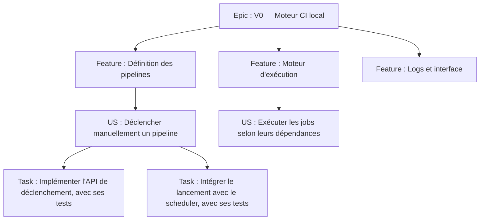

# Backlog, types de work items et Definition of Ready

## 2. Hiérarchie du backlog

Hiérarchie habituelle : **Epic → Feature → US → Task**. Utiliser les liens Azure `Parent / Child` ; les Tests font partie de la réalisation des Tasks et ne nécessitent pas leurs propres Tasks. Les Bugs et Issues sont traités selon les sections correspondantes.

### 2.1. Epic : lot ou version de Rustkins

**Usage :** chaque Epic représente un lot cohérent qui doit pouvoir être achevé, testé et livré (V0, V1, V2, V3…). Les Epics **ne représentent pas les microservices** ou les domaines techniques.

**Champs recommandés :**

| Champ | Contenu attendu |
|---|---|
| Title | `V0 — Moteur CI local viable`, `V1 — Utilisation en équipe`, etc. |
| Description | Objectif de la version, périmètre, hors périmètre, architecture cible, risques, prérequis, définition de livraison |
| Acceptance / Release criteria | Critères démontrant que la version est effectivement livrable, liens vers spécifications |
| Effort | Facultatif : agrégation des Story Points, sans re-estimer arbitrairement le total |
| Target date | Facultative : jalon de livraison ; distinguer engagement et prévision |
| Links | Référence à `RustkinsDocs`, release GitHub, déploiement et livrables |

**Clôture recommandée :** toutes les Features du périmètre de livraison sont `Closed`, les critères de release sont remplis, le lot est versionné et sa livraison est attestée. Les US reportées doivent être explicitement sorties du périmètre par décision humaine ; les clôturer fictivement est interdit.

### 2.2. Feature : dossier fonctionnel de regroupement

**Usage :** regroupement lisible des US par capacité principale dans une version. Elle sert surtout à naviguer, prioriser et produire des rapports ; elle **ne doit pas devenir une mini-US** ni multiplier les estimations redondantes.

Exemples pour V0 : **Définition des pipelines**, **Ordonnancement DAG**, **Exécution Docker**, **Gestion des runs**, **Logs et interface**, **Infrastructure et déploiement**. Ces titres sont illustratifs ; le découpage final dépend du backlog réel.

**Champs recommandés :** titre court, description fonctionnelle du regroupement, Epic parent, liens aux spécifications. **Clôture recommandée :** toutes les US nécessaires et incluses dans son périmètre sont `Closed` et le regroupement est cohérent avec la version. Ne pas la clore sur la seule base des Tasks.

### 2.3. User Story : unité de valeur livrable

Une US exprime une capacité observable pour un bénéficiaire réel (utilisateur, administrateur Rustkins, mainteneur ou opérateur). Elle respecte autant que possible **INVEST** : indépendante, négociable, créatrice de valeur, estimable, suffisamment petite et testable.

**Titre préféré :** `En tant que [rôle], je veux [capacité], afin de [bénéfice]`.

**Description minimale :** contexte, rôle ou bénéficiaire, résultat attendu, règles métier, cas limites, contraintes, risques, dépendances, liens vers les spécifications et exclusions importantes.

**Critères d'acceptation (AC) :** liste de critères vérifiables, propres à l'US, idéalement scénarisés avec **Étant donné / Lorsque / Alors**. Les AC définissent le résultat attendu ; la DoD définit la qualité, les contrôles et les preuves nécessaires pour considérer l'US terminée.

**Champs de pilotage :**

| Champ | Convention |
|---|---|
| Story Points | Estimation relative combinant complexité, effort et incertitude ; requise avant engagement dans un sprint |
| Business Value | Valeur fonctionnelle de 1 à 10 ; champ personnalisé si nécessaire |
| Risk | `Low / Medium / High`, impact si la livraison est retardée ou impossible |
| Priority / Stack Rank | Priorité et ordre de traitement du backlog, pilotés par Timothy |
| Iteration Path | Sprint concerné, distinct de la version suivie par l'Epic parent |
| Area Path | Domaine de l'équipe si utile ; ne remplace pas la hiérarchie Epic/Feature |
| Links | Feature parente, dépendances, PR, résultats CI, documentation et déploiement test |

**Aucune estimation en heures** n'est demandée au niveau de l'US. Les Story Points servent à la planification relative, sans conversion automatique en heures.

Une US ne doit pas être créée uniquement parce qu'une intervention prend du temps : refactoring, maintenance ou POC peuvent relever d'une Task ou Issue. Une capacité fonctionnelle nouvelle nécessite en revanche une US et une validation humaine préalable de sa création.

### 2.4. Task : action exécutable et vérifiable

Une Task est une action concrète de développement, d'infrastructure, de documentation, d'intégration, de maintenance ou de coordination, avec **un responsable identifié et un livrable vérifiable**.

**Titre :** verbe d'action + objet, par exemple `Implémenter la validation des dépendances du DAG`.

**Champs :** US parente quand applicable, description, critères de fin, `Assigned To`, catégorie `Activity` (développement, documentation, infrastructure, etc.), dépendances et liens vers PR/CI. **Pas d'estimation horaire** obligatoire pour les Tasks.

**Règle explicite : ne jamais découper automatiquement une Task de développement en Tasks « tests unitaires », « tests d'intégration » et « tests E2E ».** Les agents conçoivent, écrivent, actualisent et exécutent les tests correspondants **au fur et à mesure du développement de chaque Task**. La DoD impose ces contrôles sans nécessiter de Tasks dédiées. Pour l'E2E global de l'US, les vérifications s'effectuent avant son passage à `Resolved`.

Une Task indépendante reste possible pour un véritable livrable transversal, même sans US parente. Les interventions trop petites pour justifier un suivi Azure sont consignées uniquement dans `RustkinsActivity`.

### 2.5. Bug : défaut de comportement

Un Bug décrit un comportement réel contraire à un comportement attendu, que le défaut soit fonctionnel, technique ou lié à la sécurité.

**Informations attendues :** titre explicite, étapes de reproduction, résultat observé, résultat attendu, version/commit et environnement, niveau de sévérité, priorité, preuves (logs/captures) et liens vers l'US ou la Feature concernée.

**Sévérité** = impact du défaut ; **priorité** = ordre de traitement décidé par Timothy.

**Politique de suivi des Bugs :**

1. Les Bugs sont visibles dans le **Product Backlog au même niveau que les US** (configuration Azure Boards : *Bugs as requirements*), afin de pouvoir les prioriser et les placer dans un sprint.
2. Lorsqu'un défaut apparaît **pendant la réalisation d'une Task**, l'agent le corrige dans cette Task et met à jour les tests ; il ne crée pas automatiquement un Bug pour chaque échec de test. Il crée un Bug si le problème justifie un suivi distinct (défaut complexe, régression, dépendance externe, blocage ou report).
3. Un défaut invalidant les AC ou la DoD d'une **US non clôturée** empêche son passage à `Resolved`. Un Bug lié ne remplace pas la correction de l'US engagée.
4. Un défaut découvert **après la clôture de l'US** est suivi dans un nouveau Bug, lié à l'US et à la Feature concernées. On ne rouvre pas systématiquement l'US livrée pour une régression ultérieure.
5. Les Bugs sont triés par **Critical / High / Medium / Low**. Un Bug critique (sécurité, perte de données, plateforme inutilisable) est signalé immédiatement à l'équipe ; Timothy arbitre son entrée dans le sprint et l'éventuelle modification du Sprint Goal. Les autres Bugs sont priorisés au backlog.
6. Le temps consacré aux Bugs réduit la capacité disponible pour les US : il est rendu visible dans les rapports de sprint, mais **un Bug corrigé ne se compte pas comme une US livrée**. Le suivi des Bugs (nombre, sévérité, corrigés/reports) est présenté séparément de la vélocité des US.
7. La DoD d'un Bug exige reproduction ou diagnostic suffisamment étayé, correctif vérifié, tests de non-régression exécutés et preuve du résultat. Un Bug bloquant ne peut pas être simplement fermé pour permettre artificiellement la clôture de l'US.

Cette politique de suivi des Bugs est **validée par l’équipe** et s’applique à l’ensemble du projet.

### 2.6. Issue : investigation / POC / incertitude

Dans le processus Agile, le type `Issue` existe pour tracer des problèmes ou obstacles mais n'apparaît **pas forcément sur le backlog produit** par défaut. Rustkins l'utilise pour une investigation ou un POC qui mérite d'être suivi ; le type et sa visibilité doivent être vérifiés dans la configuration Azure Boards.

**Livrable :** analyse documentée, POC, recommandation, décision demandée, ou constat explicite d'échec avec suites. La clôture suppose ce livrable, pas obligatoirement du code.

**À éviter :** utiliser `Issue` pour des besoins utilisateur qui devraient être des US, ou comme doublon d'un Bug. Pour une véritable décision d'architecture, la décision validée vit ensuite dans `RustkinsDocs` (ADR), pas seulement dans l'Issue.

---

## 4. Definition of Ready (DoR) — avant engagement d'une US

Une US peut exister dans le product backlog sans remplir la DoR. **Avant de la sélectionner pour un sprint**, la revue de raffinement doit confirmer :

- [ ] Besoin compris, bénéficiaire et bénéfice identifiés.
- [ ] Description, périmètre et principaux cas limites suffisamment clairs.
- [ ] Acceptance Criteria **vérifiables** et non contradictoires.
- [ ] Dépendances, risques et hypothèses identifiés ; aucune dépendance rédhibitoire ignorée.
- [ ] Story Points estimés collectivement, sans estimation horaire supplémentaire.
- [ ] Business Value et ordre de priorité renseignés selon la convention retenue.
- [ ] Stratégie de tests unitaires, intégration et E2E **réalisable** ; besoins d'environnement et de jeux de données connus.
- [ ] Taille adaptée à un sprint ; sinon, découpage fonctionnel en US indépendamment validables.
- [ ] Feature et Epic parents corrects ; aucune US équivalente déjà existante.
- [ ] Création de l'US approuvée par un humain (si nouvelle).

**Politique pour les agents :** un skill peut proposer un découpage et signaler que la DoR n'est pas atteinte. Timothy confirme les changements de planification ; l'agent ne les déduit pas implicitement.

---

