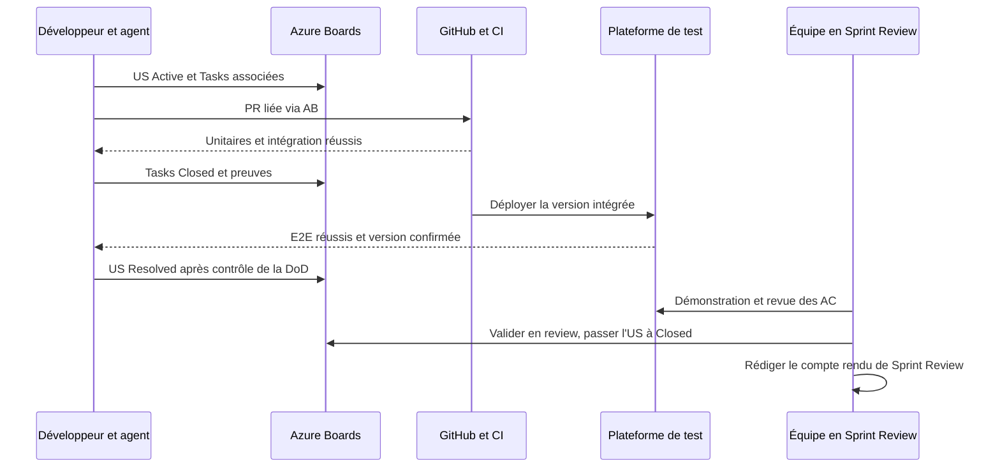

# Exemple de User Story V0 et indicateurs

## 1. Exemple complet — US V0

**Epic :** `V0 — Moteur CI local viable`  
**Feature :** `Exécution des pipelines`  
**US :** `En tant que mainteneur de projet, je veux déclencher manuellement un pipeline afin de vérifier mes modifications à la demande.`

**Description :** déclenchement manuel d'un pipeline YAML valide sur dépôt public, création d'un run, ordonnancement des jobs et consultation du résultat ; hors périmètre : authentification avancée et secrets V2.

**Critères d'acceptation :**

- **AC-1 :** **Étant donné** un pipeline valide et un dépôt public, **lorsque** l'utilisateur déclenche le pipeline, **alors** un run est créé avec un identifiant consultable.
- **AC-2 :** **Étant donné** un run créé, **lorsque** le moteur l'exécute, **alors** les jobs démarrent dans l'ordre autorisé par `needs`.
- **AC-3 :** **Étant donné** la fin du traitement, **lorsque** l'utilisateur consulte le run, **alors** son statut final reflète les résultats des jobs.
- **AC-4 :** **Étant donné** une définition invalide, **lorsque** l'utilisateur demande un déclenchement, **alors** une erreur explicite est retournée et aucun run exécutable n'est lancé.

**Tasks possibles (les tests sont compris dans chacune) :**

1. Implémenter l'API de déclenchement et sa validation, avec tests unitaires et d'intégration correspondants.
2. Implémenter la création du run et son envoi au scheduler, avec tests des interactions correspondantes.
3. Rendre l'exécution et son résultat consultables, avec scénarios automatisés correspondants.

**Avant `Resolved` :** toutes les Tasks sont `Closed`, tous les AC sont couverts, les tests unitaires, intégration et E2E réussissent, la PR est reliée à l'US via Azure Boards pour GitHub et la fonctionnalité est déployée sur la plateforme de test.

**Pendant la Sprint Review :** démonstration sur la plateforme de test, acceptation humaine par l'équipe, mention dans le compte rendu et **passage de `Resolved` à `Closed`**. Les suggestions d'amélioration deviennent de nouveaux éléments de backlog au sprint suivant.

---

## 2. Indicateurs de pilotage

Les indicateurs sont issus en priorité d'Azure Boards, des résultats CI/GitHub et des journaux `RustkinsActivity`. Ils doivent rester compréhensibles et ne pas transformer le volume des activités individuelles en mesure de productivité.

| Indicateur | Définition |
|---|---|
| US terminées | Nombre et Story Points des US passées à `Closed` **pendant la Sprint Review** |
| US prêtes pour la review | Nombre et Story Points des US `Resolved` avant la Sprint Review |
| US reportées | US non entièrement `Resolved` au terme du sprint, avec raisons et sprint suivant |
| Éléments bloqués | US/Tasks dans l'état `Blocked`, prédécesseurs et actions attendues |
| Éléments en pause | US/Tasks dans l'état `On Hold`, motif et condition de reprise |
| Avancement du sprint | Story Points engagés vs Story Points des US `Closed`, sans crédit partiel |
| Qualité | Réussite/échec des tests unitaires, d'intégration et E2E ; déploiements confirmés |
| Bugs | Nombre de Bugs ouverts/corrigés, sévérité et reports ; suivi distinct des US et de leur vélocité |
| Activités | Interventions documentées par période et sujet, sans classement de productivité par personne |
| Décisions de sprint | Compte rendu de review et de retrospective, actions identifiées et suivi |

Les activités liées à une Task ne doivent pas être comptées comme des livrables supplémentaires. **Aucun indicateur de délai `Resolved` → `Closed` n'est nécessaire** : la clôture des US a lieu à la Sprint Review.

---

