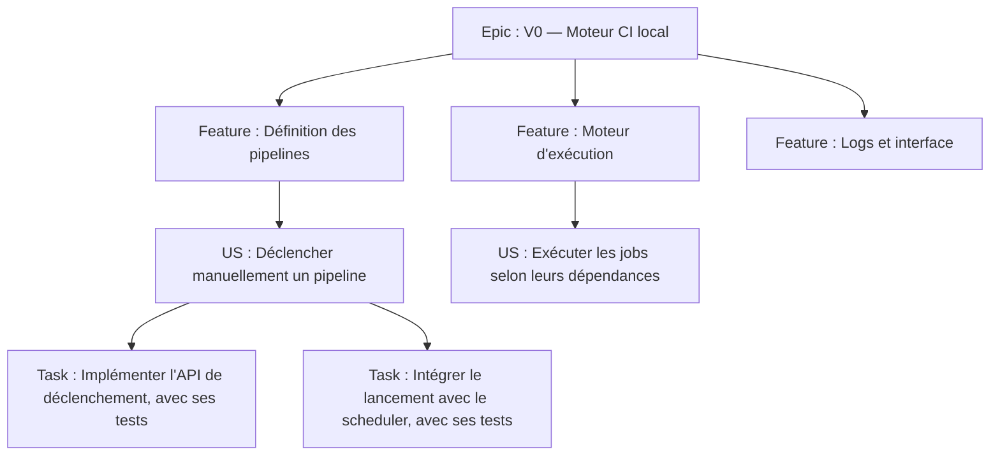
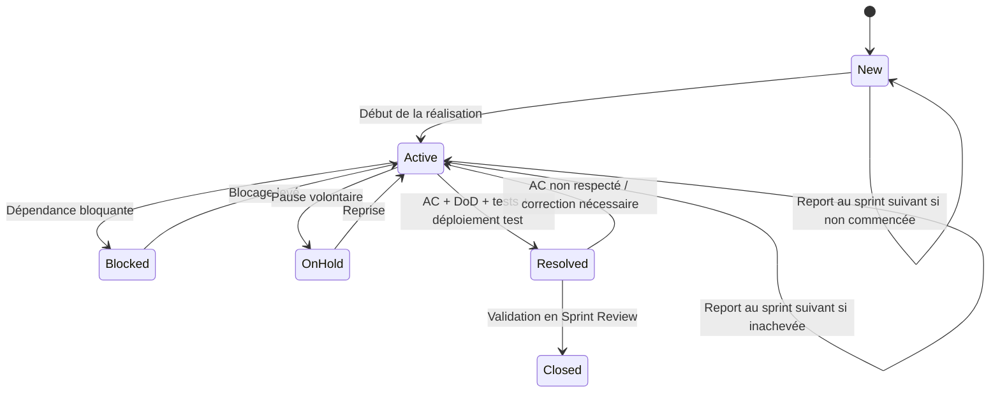
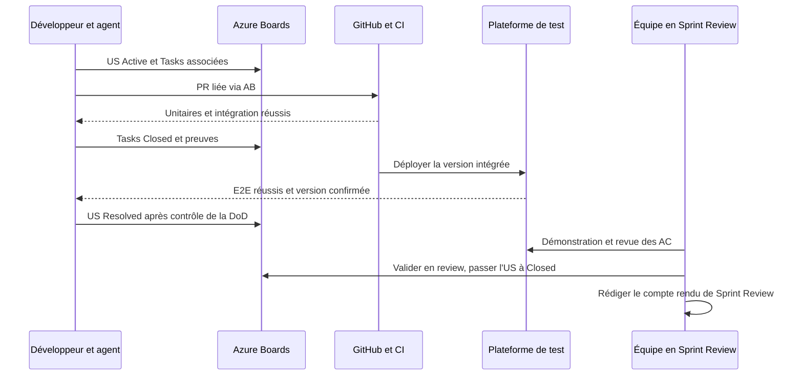

# Rustkins — Gestion de projet Agile et utilisation d'Azure Boards

> **Statut :** règles de gestion de projet Rustkins, utilisables comme référentiel pour les développeurs et les agents IA.  
> **Version : 1.1 — 2026-11-03**  
> **Périmètre :** développement de Rustkins (V0, V1, V2, V3 et versions ultérieures), gestion du backlog, des sprints et des interventions.  
> **Emplacement :** `RustkinsDocs/docs/project-management/project-management.md`.  
> **Équipe :** Timothy, Alexis et Loick.

## 1. Objectif et principes directeurs

Ce document définit la gestion Agile de Rustkins : hiérarchie des éléments de travail, préparation des sprints, colonnes Azure Boards, responsabilités, critères d'acceptation, **Definition of Ready (DoR)** et **Definition of Done (DoD)**. Il constitue une référence pour l'équipe et un socle métier pour les futurs skills Codex et Claude Code.

1. **Azure Boards est la source officielle** des Epics, Features, US, Tasks, Bugs, Issues, priorités, itérations et états. `RustkinsActivity` conserve le journal des interventions, sans copier le backlog.
2. **Epic = version / lot** ; **Feature = fonctionnalité principale regroupant les US** ; **US = capacité vérifiable** ; **Task = action technique ou organisationnelle suivie**.
3. Une **nouvelle US** n'est jamais créée par un agent sans **validation explicite d'un membre de l'équipe** après recherche des éléments existants.
4. Une **Task** est créée lorsqu'un suivi est justifié, après recherche des Tasks existantes. Les petites interventions peuvent être consignées uniquement dans `RustkinsActivity`.
5. **Les tests font partie intégrante du développement et de la DoD**. Ne pas créer de Tasks séparées pour écrire ou exécuter les tests unitaires, d'intégration ou E2E : les agents les réalisent en continu avec les Tasks de développement.
6. Une US passe à **`Resolved`** seulement lorsque tous ses critères d'acceptation sont respectés, que ses tests unitaires, d'intégration et E2E sont réussis, que toutes ses Tasks sont `Closed` et qu'elle est déployée sur la plateforme de test.
7. Une US passe à **`Closed` pendant la Sprint Review**, après validation humaine de l'équipe. Une US simplement `Resolved` n'est pas encore considérée comme terminée.
8. **`Blocked` et `On Hold` sont à la fois des états Azure DevOps (`System.State`) et des colonnes dédiées du Board**, pour les US et les Tasks. Ils sont créés dans le processus Agile hérité, en catégorie **In Progress**, afin de représenter respectivement une dépendance bloquante et une pause volontaire sans compter le travail comme terminé.
9. **Timothy pilote le Product Backlog et les modifications du Sprint Backlog en cours de sprint.** Les décisions de produit, d'architecture et de validation impliquent l'équipe de trois personnes : Timothy, Alexis et Loick.
10. Aucun agent ne doit inventer une preuve de test, de déploiement ou de validation, ni annoncer une modification Azure/GitHub non confirmée.

L'équipe travaille sur son temps libre : le suivi est prioritairement **asynchrone** via Azure Boards, `RustkinsActivity` et les récapitulatifs Discord ; il n'y a pas de Daily obligatoire.

---

## 2. Hiérarchie du backlog

Hiérarchie habituelle : **Epic → Feature → US → Task**. Utiliser les liens Azure `Parent / Child` ; les Tests font partie de la réalisation des Tasks et ne nécessitent pas leurs propres Tasks. Les Bugs et Issues sont traités selon les sections correspondantes.

### 2.1. Epic : lot ou version de Rustkins

**Usage :** chaque Epic représente un lot cohérent qui doit pouvoir être achevé, testé et livré (V0, V1, V2, V3…). Les Epics **ne représentent pas les microservices** ou les domaines techniques.

**Champs recommandés :**

| Champ | Contenu attendu |
|---|---|
| Title | `V0 — Moteur CI local viable`, `V1 — Utilisation en équipe`, etc. |
| Description | Objectif de la version, périmètre, hors périmètre, architecture cible, risques, prérequis, définition de livraison |
| Acceptance / Release criteria | Critères démontrant que la version est effectivement livrable, liens vers spécifications |
| Effort | Facultatif : agrégation des Story Points, sans re-estimer arbitrairement le total |
| Target date | Facultative : jalon de livraison ; distinguer engagement et prévision |
| Links | Référence à `RustkinsDocs`, release GitHub, déploiement et livrables |

**Clôture recommandée :** toutes les Features du périmètre de livraison sont `Closed`, les critères de release sont remplis, le lot est versionné et sa livraison est attestée. Les US reportées doivent être explicitement sorties du périmètre par décision humaine ; les clôturer fictivement est interdit.

### 2.2. Feature : dossier fonctionnel de regroupement

**Usage :** regroupement lisible des US par capacité principale dans une version. Elle sert surtout à naviguer, prioriser et produire des rapports ; elle **ne doit pas devenir une mini-US** ni multiplier les estimations redondantes.

Exemples pour V0 : **Définition des pipelines**, **Ordonnancement DAG**, **Exécution Docker**, **Gestion des runs**, **Logs et interface**, **Infrastructure et déploiement**. Ces titres sont illustratifs ; le découpage final dépend du backlog réel.

**Champs recommandés :** titre court, description fonctionnelle du regroupement, Epic parent, liens aux spécifications. **Clôture recommandée :** toutes les US nécessaires et incluses dans son périmètre sont `Closed` et le regroupement est cohérent avec la version. Ne pas la clore sur la seule base des Tasks.

### 2.3. User Story : unité de valeur livrable

Une US exprime une capacité observable pour un bénéficiaire réel (utilisateur, administrateur Rustkins, mainteneur ou opérateur). Elle respecte autant que possible **INVEST** : indépendante, négociable, créatrice de valeur, estimable, suffisamment petite et testable.

**Titre préféré :** `En tant que [rôle], je veux [capacité], afin de [bénéfice]`.

**Description minimale :** contexte, rôle ou bénéficiaire, résultat attendu, règles métier, cas limites, contraintes, risques, dépendances, liens vers les spécifications et exclusions importantes.

**Critères d'acceptation (AC) :** liste de critères vérifiables, propres à l'US, idéalement scénarisés avec **Étant donné / Lorsque / Alors**. Les AC définissent le résultat attendu ; la DoD définit la qualité, les contrôles et les preuves nécessaires pour considérer l'US terminée.

**Champs de pilotage :**

| Champ | Convention |
|---|---|
| Story Points | Estimation relative combinant complexité, effort et incertitude ; requise avant engagement dans un sprint |
| Business Value | Valeur fonctionnelle de 1 à 10 ; champ personnalisé si nécessaire |
| Risk | `Low / Medium / High`, impact si la livraison est retardée ou impossible |
| Priority / Stack Rank | Priorité et ordre de traitement du backlog, pilotés par Timothy |
| Iteration Path | Sprint concerné, distinct de la version suivie par l'Epic parent |
| Area Path | Domaine de l'équipe si utile ; ne remplace pas la hiérarchie Epic/Feature |
| Links | Feature parente, dépendances, PR, résultats CI, documentation et déploiement test |

**Aucune estimation en heures** n'est demandée au niveau de l'US. Les Story Points servent à la planification relative, sans conversion automatique en heures.

Une US ne doit pas être créée uniquement parce qu'une intervention prend du temps : refactoring, maintenance ou POC peuvent relever d'une Task ou Issue. Une capacité fonctionnelle nouvelle nécessite en revanche une US et une validation humaine préalable de sa création.

### 2.4. Task : action exécutable et vérifiable

Une Task est une action concrète de développement, d'infrastructure, de documentation, d'intégration, de maintenance ou de coordination, avec **un responsable identifié et un livrable vérifiable**.

**Titre :** verbe d'action + objet, par exemple `Implémenter la validation des dépendances du DAG`.

**Champs :** US parente quand applicable, description, critères de fin, `Assigned To`, catégorie `Activity` (développement, documentation, infrastructure, etc.), dépendances et liens vers PR/CI. **Pas d'estimation horaire** obligatoire pour les Tasks.

**Règle explicite : ne jamais découper automatiquement une Task de développement en Tasks « tests unitaires », « tests d'intégration » et « tests E2E ».** Les agents conçoivent, écrivent, actualisent et exécutent les tests correspondants **au fur et à mesure du développement de chaque Task**. La DoD impose ces contrôles sans nécessiter de Tasks dédiées. Pour l'E2E global de l'US, les vérifications s'effectuent avant son passage à `Resolved`.

Une Task indépendante reste possible pour un véritable livrable transversal, même sans US parente. Les interventions trop petites pour justifier un suivi Azure sont consignées uniquement dans `RustkinsActivity`.

### 2.5. Bug : défaut de comportement

Un Bug décrit un comportement réel contraire à un comportement attendu, que le défaut soit fonctionnel, technique ou lié à la sécurité.

**Informations attendues :** titre explicite, étapes de reproduction, résultat observé, résultat attendu, version/commit et environnement, niveau de sévérité, priorité, preuves (logs/captures) et liens vers l'US ou la Feature concernée.

**Sévérité** = impact du défaut ; **priorité** = ordre de traitement décidé par Timothy.

**Politique de suivi des Bugs :**

1. Les Bugs sont visibles dans le **Product Backlog au même niveau que les US** (configuration Azure Boards : *Bugs as requirements*), afin de pouvoir les prioriser et les placer dans un sprint.
2. Lorsqu'un défaut apparaît **pendant la réalisation d'une Task**, l'agent le corrige dans cette Task et met à jour les tests ; il ne crée pas automatiquement un Bug pour chaque échec de test. Il crée un Bug si le problème justifie un suivi distinct (défaut complexe, régression, dépendance externe, blocage ou report).
3. Un défaut invalidant les AC ou la DoD d'une **US non clôturée** empêche son passage à `Resolved`. Un Bug lié ne remplace pas la correction de l'US engagée.
4. Un défaut découvert **après la clôture de l'US** est suivi dans un nouveau Bug, lié à l'US et à la Feature concernées. On ne rouvre pas systématiquement l'US livrée pour une régression ultérieure.
5. Les Bugs sont triés par **Critical / High / Medium / Low**. Un Bug critique (sécurité, perte de données, plateforme inutilisable) est signalé immédiatement à l'équipe ; Timothy arbitre son entrée dans le sprint et l'éventuelle modification du Sprint Goal. Les autres Bugs sont priorisés au backlog.
6. Le temps consacré aux Bugs réduit la capacité disponible pour les US : il est rendu visible dans les rapports de sprint, mais **un Bug corrigé ne se compte pas comme une US livrée**. Le suivi des Bugs (nombre, sévérité, corrigés/reports) est présenté séparément de la vélocité des US.
7. La DoD d'un Bug exige reproduction ou diagnostic suffisamment étayé, correctif vérifié, tests de non-régression exécutés et preuve du résultat. Un Bug bloquant ne peut pas être simplement fermé pour permettre artificiellement la clôture de l'US.

Cette politique de suivi des Bugs est **validée par l’équipe** et s’applique à l’ensemble du projet.

### 2.6. Issue : investigation / POC / incertitude

Dans le processus Agile, le type `Issue` existe pour tracer des problèmes ou obstacles mais n'apparaît **pas forcément sur le backlog produit** par défaut. Rustkins l'utilise pour une investigation ou un POC qui mérite d'être suivi ; le type et sa visibilité doivent être vérifiés dans la configuration Azure Boards.

**Livrable :** analyse documentée, POC, recommandation, décision demandée, ou constat explicite d'échec avec suites. La clôture suppose ce livrable, pas obligatoirement du code.

**À éviter :** utiliser `Issue` pour des besoins utilisateur qui devraient être des US, ou comme doublon d'un Bug. Pour une véritable décision d'architecture, la décision validée vit ensuite dans `RustkinsDocs` (ADR), pas seulement dans l'Issue.

---

## 3. Colonnes Azure Boards, états et dépendances

### 3.1. États Azure DevOps et colonnes du Board

Dans Rustkins, **un statut est un état réel du work item**, enregistré dans le champ Azure DevOps `System.State` et **représenté aussi par une colonne du Board**. Les états `Blocked` et `On Hold` seront ajoutés aux types **User Story** et **Task** dans un **processus Agile hérité**. Ils sont tous deux associés à la catégorie système **In Progress**, ce qui signifie que l'élément reste en cours et n'est pas considéré comme livré.

| Type | États prévus (et colonnes correspondantes) | Catégories des états personnalisés |
|---|---|---|
| US | `New` → `Active` / `Blocked` / `On Hold` → `Resolved` → `Closed` | `Blocked`, `On Hold` : **In Progress** ; `Resolved` : **Resolved** |
| Task | `New` → `Active` / `Blocked` / `On Hold` → `Closed` | `Blocked`, `On Hold` : **In Progress** |
| Bug | `New` → `Active` → `Resolved` → `Closed` | Conserver le workflow du Bug, sous réserve de sa configuration réelle |
| Issue | États du processus Agile configuré | Pas de personnalisation définie pour le moment |
| Epic / Feature | `New` → `Active` → `Closed` | Pas de personnalisation définie pour le moment |

`Blocked` et `On Hold` ne sont **pas deux étapes successives** : ils constituent des états alternatifs à `Active`. Le passage à `Resolved` requiert la DoD complète ; le passage de l'US à `Closed` intervient uniquement pendant la Sprint Review.

**Configuration requise :** créer `Blocked` et `On Hold` sur chacun des types US et Task, choisir la catégorie **In Progress**, puis configurer les colonnes du Board correspondant à ces états. Confirmer que l'état `Resolved` est disponible pour les US ; sinon, l'ajouter au processus hérité en catégorie **Resolved**. Ne pas confondre la **catégorie système** (`In Progress`, `Resolved`, `Completed`) avec le **nom de l'état** (`Active`, `Blocked`, `On Hold`, `Resolved`, `Closed`).

**Particularité Azure DevOps :** le Board des US et le **Taskboard du sprint** ne partagent pas exactement la même configuration d'affichage. L'ajout d'états personnalisés aux Tasks peut créer des colonnes sur le Taskboard ; il faut vérifier leur ordre et leur correspondance. Les skills doivent d'abord lire et modifier **`System.State`**, puis contrôler la colonne réellement affichée et corriger sa configuration si nécessaire. Une modification de `System.BoardColumn` seule ne suffit pas à matérialiser un changement d'état.

### 3.2. Signification des états et colonnes

| État / colonne | Signification et sortie |
|---|---|
| `New` | Travail non commencé. Peut être prêt ou non pour un sprint ; une dépendance anticipée y est référencée sans prétendre que le travail a commencé |
| `Active` | Réalisation, tests et intégration en cours ; reprise après une pause ou un blocage |
| `Blocked` | Travail commencé qui **ne peut pas avancer à cause d'une dépendance identifiée** ; lien Azure et motif obligatoires quand un work item bloquant existe |
| `On Hold` | Travail commencé temporairement **mis en pause sans dépendance bloquante**, par exemple en raison d'un changement de disponibilité ou de priorité ; raison et condition de reprise consignées |
| `Resolved` | **US :** tous les AC et la DoD sont satisfaits, tests réussis, Tasks fermées, déploiement en test prouvé ; en attente de la Sprint Review |
| `Closed` | **US :** acceptée en Sprint Review ; **Task :** sa DoD est satisfaite ; état final non utilisé pour une annulation |

Pour une US non commencée, conserver l'état `New` même si une dépendance future est connue ; le lien de dépendance peut être renseigné dès cette étape. Les états `Blocked` et `On Hold` sont réservés à un travail effectivement commencé, puis interrompu.

### 3.3. Cycle de vie d'une US

Ce diagramme représente **à la fois les transitions entre les états réels `System.State` et le déplacement de leurs cartes dans les colonnes correspondantes**. `Active`, `Blocked` et `On Hold` sont trois états distincts de la catégorie système **In Progress**.

Une interruption de travail, un arrêt de l'agent ou la fin d'une conversation ne justifie pas à lui seul `Closed`, `Resolved` ni la suppression de l'US.

### 3.4. Dépendances

Les liens Azure **`Predecessor` / `Successor`** représentent les dépendances ordonnées ; `Related` désigne une association sans ordre, et `Parent / Child` la hiérarchie.

Lorsqu'une Task ou une US est bloquée :

1. Rechercher le work item prédécesseur avant d'en créer un nouveau et ajouter le lien directionnel adapté.
2. Indiquer le motif, l'action attendue, la personne responsable du déblocage et l'effet éventuel sur le sprint.
3. Passer l'élément dans l'état `Blocked` (et sa colonne) **uniquement si le travail a commencé et qu'aucune progression utile n'est possible**.
4. Si le blocage est externe et n'a pas de work item, le documenter explicitement sans inventer un identifiant Azure.
5. Après levée du blocage, vérifier la condition effective avant le retour à `Active`.

`On Hold` est réservé aux pauses qui ne dépendent pas de la résolution d'un autre work item : une simple indisponibilité de développeur, par exemple. Les deux **états** doivent être distingués dans les requêtes Azure et les rapports, ainsi que sur les colonnes du Board.

---

## 4. Definition of Ready (DoR) — avant engagement d'une US

Une US peut exister dans le product backlog sans remplir la DoR. **Avant de la sélectionner pour un sprint**, la revue de raffinement doit confirmer :

- [ ] Besoin compris, bénéficiaire et bénéfice identifiés.
- [ ] Description, périmètre et principaux cas limites suffisamment clairs.
- [ ] Acceptance Criteria **vérifiables** et non contradictoires.
- [ ] Dépendances, risques et hypothèses identifiés ; aucune dépendance rédhibitoire ignorée.
- [ ] Story Points estimés collectivement, sans estimation horaire supplémentaire.
- [ ] Business Value et ordre de priorité renseignés selon la convention retenue.
- [ ] Stratégie de tests unitaires, intégration et E2E **réalisable** ; besoins d'environnement et de jeux de données connus.
- [ ] Taille adaptée à un sprint ; sinon, découpage fonctionnel en US indépendamment validables.
- [ ] Feature et Epic parents corrects ; aucune US équivalente déjà existante.
- [ ] Création de l'US approuvée par un humain (si nouvelle).

**Politique pour les agents :** un skill peut proposer un découpage et signaler que la DoR n'est pas atteinte. Timothy confirme les changements de planification ; l'agent ne les déduit pas implicitement.

---

## 5. Definition of Done (DoD) — les trois niveaux

### 5.1. Activité RustkinsActivity

Une activité peut être considérée achevée lorsque :

- [ ] Son objectif, son auteur/profil, sa chronologie et son contexte sont consignés.
- [ ] Les résultats réels sont indiqués ; tests et PR sont référencés lorsqu'ils existent.
- [ ] Les blocages et actions restantes sont documentés.
- [ ] L'état final est cohérent (`completed` ou `abandoned`) et la date de fin est renseignée.
- [ ] Le work item Azure lié, s'il existe, est référencé ; **son état n'est pas supposé terminé**.

La clôture d'une conversation Codex/Claude **ne clôt pas automatiquement l'activité** : un agent peut interrompre, reprendre ou passer le relais.

### 5.2. Task Azure — `Closed`

La Task est `Closed` si et seulement si :

- [ ] Le résultat précis annoncé dans la description est implémenté ou produit.
- [ ] Les tests ou vérifications **pertinents pour cette Task** ont été exécutés et réussis, preuves disponibles.
- [ ] Les modifications sont intégrées dans la branche de référence appropriée **lorsqu'une intégration est requise** ; les PR nécessaires sont revues/approuvées selon la règle d'équipe.
- [ ] La documentation et/ou les contrats concernés sont à jour, si nécessaire.
- [ ] Aucun blocage ni sous-travail connu indispensable à sa réussite n'est laissé caché.
- [ ] L'état, les liens PR/CI et le compte rendu sont mis à jour dans Azure ; l'activité associée est tenue à jour.

**Les tests sont produits et exécutés pendant les Tasks de développement, sans créer de Tasks spécifiques aux tests.** Les E2E globaux de l'US ne sont pas tous exigés pour fermer chaque Task isolément, mais ils sont **obligatoires pour résoudre l'US**. Une Task ne peut pas être clôturée si sa propre implémentation est manifestement défectueuse.

### 5.3. User Story — porte `Active` → `Resolved`

Cette **DoD technique et fonctionnelle est obligatoire**. Les conditions sont **cumulatives** :

#### A. Fonctionnalité / acceptance criteria

- [ ] Tous les AC sont satisfaits et individuellement vérifiés ; l'équipe documente la preuve ou le scénario de test correspondant.
- [ ] Les cas limites et les règles métier identifiés sont couverts.
- [ ] Aucun Bug bloquant ou défaut connu invalidant un AC n'est ouvert.

#### B. Tests : trois niveaux obligatoires

- [ ] **Tests unitaires** : implémentés/actualisés pour le périmètre de l'US, exécutés et **réussis**.
- [ ] **Tests d'intégration** : implémentés/actualisés pour les composants et échanges concernés (DB, API, RabbitMQ, stockage, Docker, etc.), exécutés et **réussis**.
- [ ] **Tests E2E** : scénarios représentatifs couvrant le parcours externe complet de l'US (API, moteur, worker, interface selon le cas), implémentés/actualisés, exécutés et **réussis**.
- [ ] La **CI de la révision livrée** est verte pour les suites pertinentes ; preuves de runs et résultats consultables.
- [ ] Aucun test rouge ou désactivé sans justification ne masque un défaut concernant l'US.

**Règle retenue :** les trois catégories de tests sont exigées pour chaque US, intégrées au flux normal de réalisation, **sans Tasks de mise en place des tests**. Pour les US très techniques, définir un E2E technique observable (par exemple, déclencher un pipeline puis vérifier le statut, les sorties et les logs), plutôt que d'omettre la catégorie de test. Toute impossibilité exceptionnelle doit faire l'objet d'une **dérogation explicite et humaine, documentée**, et non d'une décision unilatérale de l'agent ; tant qu'elle n'est pas approuvée, l'US ne peut pas passer à `Resolved`.

#### C. Intégration, documentation, dépendances

- [ ] Toutes les **Tasks enfants sont dans l'état `Closed`** (aucune `New`, `Active`, `Blocked` ou `On Hold` restante ; un retrait de périmètre nécessite une décision humaine documentée).
- [ ] Code fusionné sur la branche de référence, revues requises obtenues, et artefact/build identifié.
- [ ] Documentation utilisateur, technique, configuration, migration et ADR pertinentes mises à jour si le changement le nécessite.
- [ ] Dépendances bloquantes levées ; aucun critère de fin repoussé discrètement hors périmètre.

#### D. Plateforme de test

- [ ] La **version contenant l'US est déployée sur la plateforme de test** partagée, accessible à l'équipe.
- [ ] Commit, build, image(s) et/ou release réellement déployés sont identifiables.
- [ ] Health checks, configuration et migrations nécessaires sont corrects.
- [ ] Les E2E et validations automatisées applicables ont été exécutés **contre la version déployée**, avec résultats verts.
- [ ] L'URL ou le chemin d'accès, le pipeline de déploiement et le run de tests sont référencés sur l'US.

**Transition autorisée :** `Active` → `Resolved` seulement quand **A + B + C + D** sont satisfaits. L'US est alors **prête à être validée**, mais **pas encore terminée**.

### 5.4. User Story — porte `Resolved` → `Closed` **pendant la Sprint Review**

La **Sprint Review est le moment officiel de clôture des US du sprint**. Chaque US `Resolved` est présentée à l'équipe **Timothy, Alexis et Loick** sur la plateforme de test. L'acceptation est une décision **humaine et traçable de l'équipe**, et non une décision automatique de l'agent.

Pour passer une US à `Closed` :

- [ ] L'US était réellement `Resolved` : tous ses AC et éléments de DoD sont déjà satisfaits, les tests réussis, toutes ses Tasks `Closed`, le déploiement de test prouvé.
- [ ] La fonctionnalité a été **présentée et validée lors de la Sprint Review** par les membres de l'équipe présents.
- [ ] La décision d'acceptation, la référence à l'US, les participants et les éventuelles remarques figurent dans le **compte rendu de Sprint Review**.
- [ ] Aucun défaut connu ne remet en cause les **AC initialement convenus** ou la DoD.
- [ ] La transition vers `Closed` est effectuée au terme de cette validation, sans clôture automatique à la fusion d'une PR ou à la fin d'une session IA.

**Demandes de modification à la suite de la review :** si l'US est effectivement terminée et que les AC initiaux sont satisfaits, elle est **clôturée**. Les demandes d'amélioration, adaptations ou ajouts recueillis pendant la review deviennent, selon leur nature, **une nouvelle US, une Task autonome ou un Bug à planifier au sprint suivant**. Ne pas rouvrir l'US acceptée simplement parce que l'équipe a identifié une évolution supplémentaire.

**En revanche, si la review démontre qu'un AC initial ou la DoD n'est pas respecté, l'US n'était pas réellement terminée :** elle retourne à `Active`, la correction est tracée, puis elle est reportée si nécessaire. Une évolution hors périmètre et un manquement à l'engagement initial ne doivent pas être confondus.

Les US `Resolved` **ne deviennent `Closed` que pendant la Sprint Review**. Les US non résolues à 100 % restent ouvertes et sont traitées selon la politique de fin de sprint (§ 7.7).

### 5.5. DoD complémentaires : Bug, Issue, Feature, Epic

| Type | Critères recommandés |
|---|---|
| Bug `Resolved` | Correction intégrée, tests de non-régression écrits/exécutés, correctif déployé en test si le défaut est reproductible sur cette plateforme |
| Bug `Closed` | Correction vérifiée et acceptée, régression absente sur la révision testée |
| Issue `Closed` | Investigation réalisée, livrable/recommandation consigné, résultat diffusé ; ADR si décision structurante approuvée |
| Feature `Closed` | Toutes les US nécessaires du regroupement sont `Closed`, périmètre cohérent, aucun manque masqué |
| Epic `Closed` | Features requises `Closed`, critères du lot satisfaits, release/version préparée et livraison prouvée, accord humain pour déclarer le lot livré |

---

## 6. Politique de tests, preuves et validation

### 6.1. Niveaux de test pour Rustkins

| Niveau | Finalité | Exemple Rustkins | Preuve attendue |
|---|---|---|---|
| Unitaire | Isoler une règle / fonction | Évaluation des dépendances et états `skipped` / `failed` dans le DAG | Lien CI vers les tests unitaires, liste/cas utiles |
| Intégration | Vérifier plusieurs composants et leurs contrats | Scheduler + PostgreSQL + RabbitMQ ; Worker + Docker ou RustFS dans un environnement de test contrôlé | Lien CI vers suite intégration, logs et rapports pertinents |
| E2E | Vérifier le comportement complet observable | Déclencher un run depuis l'API, voir les jobs exécutés, récupérer le statut et les logs | Lien E2E sur la plateforme de test, version déployée et scénario réussi |

Les tests sont développés et exécutés en continu au fil des Tasks : une Task exclusivement consacrée à la mise en place des tests n'est pas créée. Un test déclaré « écrit » mais non exécuté **ne vaut pas** preuve de réussite. Les tests doivent viser la même version de référence que celle déployée en test ; une suite verte sur un autre commit ne suffit pas à elle seule.

### 6.2. Traçabilité recommandée d'une US

Dans Azure Boards, conserver au minimum :

- les PR fusionnées et les commits/artefacts effectivement déployés ;
- les résultats CI des **tests unitaires, d'intégration et E2E**, et le résultat du déploiement test ;
- l'identité de l'environnement de test et la version effectivement présente ;
- la liste des AC vérifiés et leurs preuves ;
- le **compte rendu de Sprint Review** attestant la décision humaine de validation, avec les participants (Timothy, Alexis, Loick selon présence) ;
- les Bugs et Issues significatifs, ainsi que leurs résolutions ;
- les documents actualisés dans `RustkinsDocs`.

**Association PR ↔ work item :** Rustkins utilise **l'application Azure Boards pour GitHub** afin de lier les Pull Requests GitHub aux éléments de travail Azure. Les PR référencent les identifiants Azure via la syntaxe **`AB#123`** dans leur description (ou une autre liaison explicite reconnue par l'application). Le lien doit être vérifiable depuis Azure Boards ; une simple mention textuelle non reconnue n'est pas une preuve suffisante.

**Contrôle à venir :** une **CI GitHub** vérifiera qu'une PR porte au moins une référence Azure valide et liée aux work items concernés, avant son intégration. Une référence absente, erronée ou non accessible doit faire échouer le contrôle ; la vérification complète dépendra des permissions et de l'API Azure disponibles.

**Attention :** utiliser une référence simple **`AB#123`**, sans formule de fermeture automatique telle que **`Fixes AB#123`**. Les automatismes GitHub/Azure ne doivent **jamais clôturer une US à la fusion de sa PR** : cette clôture intervient uniquement après validation à la Sprint Review.

Pour faciliter l'automatisation des vérifications, consigner ces références dans une section conventionnelle **`## Preuves de validation`** dans l'US ou dans un commentaire de validation structuré, plutôt que de multiplier immédiatement les champs Azure personnalisés.

### 6.3. Cas particuliers

- **Tests rouges** : aucune transition vers `Resolved`, même si le développeur les estime non pertinents, sans analyse et décision explicite.
- **Tests E2E instables** : fiabiliser ou isoler la cause ; ne pas traiter un seul run vert aléatoire comme validation robuste.
- **Plateforme indisponible** : l'US reste `Active`, `Blocked` ou `On Hold` selon la cause réelle ; ne pas passer `Resolved` par anticipation.
- **Changement pendant la recette** : réexécuter les contrôles pertinents sur le nouvel artefact déployé.
- **Dérogation de tests** : accord humain explicite et traçable, durée/portée définies, dette suivie ; elle ne doit jamais être implicite.

---

## 7. Gestion du Product Backlog, des Sprints et de l'Agilité

### 7.1. Product Backlog

Le Product Backlog est maintenu et ordonné par **Timothy**, avec les propositions et l'expertise de **Timothy, Alexis et Loick**. Il contient les US des lots Rustkins V0 et suivants, les Bugs suivis et les investigations utiles. Les priorités tiennent compte de la valeur, des dépendances, des risques et de la capacité réelle de l'équipe.

Les Epics représentent les **versions**, pas les sprints. Une US hérite du périmètre de version par son Epic parent, tandis que le champ `Iteration Path` indique le sprint où elle est engagée. Les sprints peuvent traverser plusieurs Features.

### 7.2. Raffinement

L'équipe clarifie les US, vérifie leur INVEST/DoR, identifie les dépendances, les découpe en unités livrables lorsque nécessaire, estime leurs Story Points et évalue leur Business Value. **Timothy ordonne le backlog** et arbitre la sélection des US ; chaque création d'US proposée par un agent nécessite une validation humaine explicite préalable.

**Éviter le surdécoupage :** backend, interface, base de données et infrastructure sont le plus souvent des Tasks d'une même US si elles concourent au même comportement observable. **Les tests ne sont pas des Tasks séparées** : ils accompagnent chaque Task de développement et conditionnent la DoD globale de l'US.

### 7.3. Sprint Planning

1. Définir en équipe le **Sprint Goal**, simple et vérifiable.
2. Évaluer les disponibilités réelles des trois développeurs pour la période : Rustkins est un projet personnel ; les temps libres peuvent varier d'un sprint à l'autre.
3. Sélectionner les US répondant à la DoR, selon priorité, dépendances et capacité ; utiliser les Story Points comme mesure relative, **sans estimation en heures des US ou des Tasks**.
4. Décomposer les US retenues en Tasks techniques ou organisationnelles utiles, avec responsables et résultats attendus. Les tests sont compris dans ces Tasks et dans la DoD.
5. Associer les work items au bon sprint via `Iteration Path` et relire les liens parents/dépendances.
6. Signaler les risques et convenir des actions préventives.

### 7.4. Pendant le sprint

- Le **Sprint Goal** reste stable ; des ajustements de Tasks peuvent être nécessaires.
- **Timothy est responsable des modifications du Sprint Backlog en cours de sprint** : ajout/retrait d'US, changement de priorité, transfert d'un Bug ou ajustement de périmètre. Les agents proposent et justifient ; Timothy décide et en consigne la raison et l'impact.
- Les Tasks supplémentaires sont créées uniquement si leur suivi apporte de la valeur, **jamais pour matérialiser automatiquement l'écriture des tests**.
- Un Bug peut être enregistré à tout moment ; sa prise en charge dans le sprint est arbitrée par Timothy, en concertation avec l'équipe lorsque l'objectif de sprint est menacé.
- Chaque développeur et son agent actualisent Azure Boards et leurs fiches dans `RustkinsActivity` à mesure que le travail progresse ; les résultats CI et les PR fournissent les preuves techniques.
- Les états et colonnes `Blocked` et `On Hold` rendent visibles respectivement les dépendances bloquantes et les mises en pause.

### 7.5. Suivi asynchrone, sans Daily obligatoire

Rustkins est développé par **trois personnes sur leur temps libre**, sans présence ni activité quotidienne garantie. Une cérémonie Daily systématique serait peu utile et risquerait de mobiliser du temps sans apporter de progrès.

**Le suivi quotidien est donc asynchrone :** chaque intervention significative est consignée dans `RustkinsActivity`, et les états/sprints sont mis à jour dans Azure Boards. Les autres membres de l'équipe peuvent ainsi connaître à tout moment : ce qui est en cours, terminé, bloqué, en pause, les US `Resolved`, les PR, les résultats de tests et les prochaines actions.

Le bot Discord peut produire des **rapports réguliers déterministes** à partir d'Azure Boards et des journaux d'activité, enrichis au besoin par les PR, CI et déploiements GitHub. Une synthèse IA facultative peut faciliter la lecture, sans inventer de faits. La présence d'un rapport ne signifie pas que les trois développeurs ont travaillé ce jour-là.

Un échange synchrone reste utile **à la demande**, par exemple pour lever une dépendance, décider d'une architecture, résoudre un blocage ou préparer une livraison ; il ne prend pas la forme d'un Daily imposé.

### 7.6. Sprint Review et Retrospective

**Sprint Review — validation des fonctionnalités et clôture des US :**

1. Réunir l'équipe (Timothy, Alexis et Loick) et consulter la liste des US `Resolved` du sprint.
2. Présenter les fonctionnalités sur la **plateforme de test**, avec les AC et preuves de tests.
3. Valider humainement chaque US conforme ; **la passer de `Resolved` à `Closed` pendant la review** et noter la décision.
4. Recueillir les remarques. Une US terminée et conforme reste `Closed` ; les améliorations demandées donnent lieu à de nouveaux work items, planifiés par Timothy au sprint suivant. Si un AC initial n'est pas respecté, l'US retourne à `Active`.
5. Dresser la liste des US non achevées et des reports.
6. Rédiger un **compte rendu de Sprint Review** : sprint/date/participants, objectif, US démontrées et validées avec leurs identifiants, décisions `Closed` ou report, remarques, Bugs/évolutions créés, liens vers preuves et actions suivantes.

**Sprint Retrospective — amélioration de la manière de travailler :**

1. Les trois développeurs discutent de ce qui a bien fonctionné et des difficultés (PR, CI, qualité des tests, blocages, organisation asynchrone, charges imprévues).
2. Choisir **quelques actions concrètes, attribuées et vérifiables** pour le sprint suivant, sans créer inutilement un grand nombre de Tasks.
3. Rédiger un **compte rendu de Sprint Retrospective** : sprint/date/participants, constats positifs, points à améliorer, décisions, actions, responsables et suivi au sprint suivant.

Les deux comptes rendus sont **obligatoires pour chaque sprint** et conservés dans `RustkinsDocs`, par exemple sous `docs/project-management/sprints/<sprint>/review.md` et `retrospective.md`. Ils peuvent être référencés dans Azure Boards et dans les rapports Discord. Les décisions collectives significatives peuvent donner lieu à une ADR séparée.

### 7.7. Fin de sprint et report des US

- **US `Closed` pendant la Sprint Review :** considérée comme terminée et comptabilisée parmi les livraisons du sprint.
- **US `Resolved` avant la review :** présentée pour validation ; si acceptée, passage à `Closed` **pendant la review**. Si un AC initial échoue, retour à `Active` puis report.
- **US non résolue à 100 % à la fin du sprint :** elle **n'est pas clôturée**. Elle reste `New` si aucun travail n'a commencé, `Active` si le développement se poursuit, ou `Blocked` / `On Hold` si l'interruption persiste ; tous ces états signifient **non terminée**. Timothy la **déplace au sprint suivant** sans forcer artificiellement son état à `Active`. Si le travail a déjà commencé, il peut rester dans l'état `Blocked` ou `On Hold` lorsque cette situation persiste : ces deux états demeurent **non terminés**, comme `Active`.
- **US finie mais nécessitant de nouveaux ajustements révélés en review :** si tous les AC initiaux et la DoD sont satisfaits, elle est **fermée**. Les demandes supplémentaires deviennent une **nouvelle US, une Task ou un Bug** du sprint suivant, selon leur nature et après arbitrage du backlog.
- **Tasks `Closed` rattachées à une US reportée :** elles restent fermées et historiquement liées à leur réalisation ; seules les Tasks inachevées poursuivent leur suivi.
- **Story Points** : ne comptabiliser comme livrés que les SP des US effectivement `Closed` après la review ; aucun crédit partiel pour une US inachevée.

Ne jamais clore artificiellement une US pour améliorer les indicateurs, ni modifier rétrospectivement les sprints pour masquer un report. Timothy documente les décisions de replanification.

---

## 8. Règles opérationnelles des agents et skills

### 8.1. Détection et création

1. Identifier si la demande relève d'une **petite activité**, d'une **Task**, d'une **US**, d'un **Bug** ou d'une **Issue**.
2. Consulter `RustkinsDocs` de façon ciblée et synchroniser le clone de lecture si nécessaire.
3. Rechercher les work items Azure existants, y compris ceux liés à une US, et éviter les doublons.
4. **Petite intervention** : créer/compléter une activité `RustkinsActivity`, sans ticket Azure obligatoire.
5. **Travail suivi** : se rattacher au work item existant ; créer une Task si la valeur d'un suivi le justifie et si sa parenté est appropriée.
6. **Nouveau besoin fonctionnel absent du backlog** : formuler l'US, ses AC, sa Feature/Epic et **demander l'autorisation humaine** avant toute création.
7. **Anomalie** : créer un Bug si le défaut justifie un suivi ; rattacher le Bug à la fonctionnalité impactée.
8. **Recherche / POC** : utiliser une Issue si le sujet demande un livrable et une priorisation ; sinon journaliser l'activité.

### 8.2. Mise à jour des états et colonnes

| Action proposée par l'agent | Règle de sécurité |
|---|---|
| Créer une activité | Autorisé selon la convention Git du journal |
| Ouvrir / renseigner une Task | Autorisé si elle justifie un suivi et n'existe pas déjà ; les tests sont intégrés aux Tasks de développement |
| Créer une US | **Validation préalable explicite d'un des trois humains** après recherche du backlog existant |
| Passer une Task à `Closed` | Vérifier la DoD de la Task et les preuves pertinentes |
| Passer une Task/US à l'état `Blocked` | Dépendance vérifiée, lien/motif renseigné, effet sur le sprint visible ; vérifier la colonne du Board |
| Passer une Task/US à l'état `On Hold` | Pause justifiée, sans dépendance bloquante, avec condition de reprise ; vérifier la colonne du Board |
| Passer une US à `Resolved` | **Contrôler tous les AC, les trois niveaux de tests, toutes les Tasks `Closed` et le déploiement test** |
| Passer une US à `Closed` | **Uniquement après validation humaine à la Sprint Review**, décision présente au compte rendu |
| Ajouter/retirer/replanifier une US pendant le sprint | **Arbitrage par Timothy** et justification écrite |
| Clore un Epic / livrer une version | Critères du lot remplis et validation humaine de l'équipe |

Pour `Blocked` et `On Hold`, les skills doivent modifier **`System.State`** vers l'état personnalisé correspondant (après vérification qu'il existe sur le type US/Task), puis s'assurer que la carte apparaît dans **la colonne homonyme** du Board ou du Taskboard. Ils ne doivent pas confondre état du work item et simple préférence d'affichage du Board.

**Idempotence :** relire l'état courant, la colonne et les relations avant chaque mutation ; éviter tout doublon après reprise de session ou nouvel essai. Un conflit entraîne une nouvelle lecture puis un arbitrage, pas un écrasement silencieux.

**Aucune annonce de réussite** sans confirmation par Azure, GitHub ou Git.

### 8.3. Automatisation DoD graduelle

**Contrôles automatisables :** statut des Tasks enfants, présence des AC, résultats CI sur la révision cible, déploiement test, liens E2E, dépendances, état/liaison des PR `AB#...`, documentation et référence au compte rendu de review.

**Contrôles nécessitant un jugement humain de Timothy, Alexis ou Loick :** qualité réelle des AC, dérogations, validation produit en review, arbitrage de périmètre et validation de livraison d'une version. Le Sprint Backlog est piloté par Timothy.

Les skills peuvent calculer `eligible_for_resolved` et `eligible_for_closed` comme **recommandations**, jamais comme preuves à eux seuls. En particulier, `eligible_for_closed` ne déclenche pas la clôture hors Sprint Review, même si tous les tests sont verts.

---

## 9. Exemple complet — US V0

**Epic :** `V0 — Moteur CI local viable`  
**Feature :** `Exécution des pipelines`  
**US :** `En tant que mainteneur de projet, je veux déclencher manuellement un pipeline afin de vérifier mes modifications à la demande.`

**Description :** déclenchement manuel d'un pipeline YAML valide sur dépôt public, création d'un run, ordonnancement des jobs et consultation du résultat ; hors périmètre : authentification avancée et secrets V2.

**Critères d'acceptation :**

- **AC-1 :** **Étant donné** un pipeline valide et un dépôt public, **lorsque** l'utilisateur déclenche le pipeline, **alors** un run est créé avec un identifiant consultable.
- **AC-2 :** **Étant donné** un run créé, **lorsque** le moteur l'exécute, **alors** les jobs démarrent dans l'ordre autorisé par `needs`.
- **AC-3 :** **Étant donné** la fin du traitement, **lorsque** l'utilisateur consulte le run, **alors** son statut final reflète les résultats des jobs.
- **AC-4 :** **Étant donné** une définition invalide, **lorsque** l'utilisateur demande un déclenchement, **alors** une erreur explicite est retournée et aucun run exécutable n'est lancé.

**Tasks possibles (les tests sont compris dans chacune) :**

1. Implémenter l'API de déclenchement et sa validation, avec tests unitaires et d'intégration correspondants.
2. Implémenter la création du run et son envoi au scheduler, avec tests des interactions correspondantes.
3. Rendre l'exécution et son résultat consultables, avec scénarios automatisés correspondants.

**Avant `Resolved` :** toutes les Tasks sont `Closed`, tous les AC sont couverts, les tests unitaires, intégration et E2E réussissent, la PR est reliée à l'US via Azure Boards pour GitHub et la fonctionnalité est déployée sur la plateforme de test.

**Pendant la Sprint Review :** démonstration sur la plateforme de test, acceptation humaine par l'équipe, mention dans le compte rendu et **passage de `Resolved` à `Closed`**. Les suggestions d'amélioration deviennent de nouveaux éléments de backlog au sprint suivant.

---

## 10. Indicateurs de pilotage

Les indicateurs sont issus en priorité d'Azure Boards, des résultats CI/GitHub et des journaux `RustkinsActivity`. Ils doivent rester compréhensibles et ne pas transformer le volume des activités individuelles en mesure de productivité.

| Indicateur | Définition |
|---|---|
| US terminées | Nombre et Story Points des US passées à `Closed` **pendant la Sprint Review** |
| US prêtes pour la review | Nombre et Story Points des US `Resolved` avant la Sprint Review |
| US reportées | US non entièrement `Resolved` au terme du sprint, avec raisons et sprint suivant |
| Éléments bloqués | US/Tasks dans l'état `Blocked`, prédécesseurs et actions attendues |
| Éléments en pause | US/Tasks dans l'état `On Hold`, motif et condition de reprise |
| Avancement du sprint | Story Points engagés vs Story Points des US `Closed`, sans crédit partiel |
| Qualité | Réussite/échec des tests unitaires, d'intégration et E2E ; déploiements confirmés |
| Bugs | Nombre de Bugs ouverts/corrigés, sévérité et reports ; suivi distinct des US et de leur vélocité |
| Activités | Interventions documentées par période et sujet, sans classement de productivité par personne |
| Décisions de sprint | Compte rendu de review et de retrospective, actions identifiées et suivi |

Les activités liées à une Task ne doivent pas être comptées comme des livrables supplémentaires. **Aucun indicateur de délai `Resolved` → `Closed` n'est nécessaire** : la clôture des US a lieu à la Sprint Review.

---

## 11. Configuration Azure DevOps pour les futurs skills

1. Confirmer le projet Azure Boards, son processus Agile et la disponibilité des work item types `Epic`, `Feature`, `User Story`, `Task`, `Bug` et `Issue` ; configurer les Bugs au niveau des US dans le Product Backlog (**Bugs as requirements**), conformément à la politique de suivi validée.
2. Dans le **processus Agile hérité**, créer les états **`Blocked` et `On Hold` sur les US et les Tasks**, tous deux en catégorie système **In Progress**. Les deux états doivent être visibles dans le champ Azure `System.State` et requêtables par les futurs skills.
3. Configurer les **colonnes homonymes `Blocked` et `On Hold`** sur le Board des US et vérifier leur correspondance avec les nouveaux états ; examiner séparément les colonnes créées ou affichées sur le **Taskboard des sprints**.
4. Vérifier les états des US : `New`, `Active`, `Blocked`, `On Hold`, `Resolved`, `Closed` ; si `Resolved` n'est pas présent, l'ajouter en catégorie **Resolved**. Vérifier ceux des Tasks : `New`, `Active`, `Blocked`, `On Hold`, `Closed`. Confirmer le comportement des changements d'état sur des work items de test avant l'automatisation.
5. Disposer de **Story Points** et de **Business Value (1–10)** pour les US. **Aucun champ d'estimation horaire spécifique n'est nécessaire** pour les US ni les Tasks.
6. Installer/configurer **Azure Boards pour GitHub** sur les dépôts concernés ; valider l'association PR ↔ work item avec `AB#<id>`.
7. Ajouter une **CI de contrôle des liens PR ↔ work items** : refuser une PR sans lien Azure valide, sans pour autant provoquer une clôture automatique de l'US.
8. Définir les **preuves de DoD** lisibles par les skills : trois types de tests verts, Tasks `Closed`, version déployée sur plateforme de test, AC vérifiés, liens PR et documentation.
9. Prévoir la traçabilité de la **validation collective durant la Sprint Review** dans le compte rendu et, selon les possibilités Azure, dans un commentaire ou un champ de référence.
10. Créer les vues/requêtes de suivi nécessaires : US `Resolved`, US non terminées en fin de sprint, PR non liées, Bugs, dépendances et éléments dont **`System.State` vaut `Blocked` ou `On Hold`**. Contrôler aussi l'affichage de ces états dans les colonnes du Board et du Taskboard.
11. Tester chaque opération de lecture/modification sur des work items de test, et vérifier les permissions avant de l'autoriser à un agent.

> **Note technique :** Rustkins choisit volontairement **de vrais états `System.State` ET leurs colonnes homonymes** pour `Blocked` et `On Hold`. Une colonne personnalisée n'est pas en elle-même un état ; il faut donc créer les états dans le processus hérité, les associer au Board, et vérifier leur représentation sur le Taskboard.

---

## 12. Gouvernance et responsabilités

**L'équipe projet est constituée de Timothy, Alexis et Loick.** Ces trois membres sont les personnes habilitées à prendre les décisions humaines requises par le projet : création des nouvelles US, validation fonctionnelle, décisions d'architecture, dérogations exceptionnelles et validation des versions. Les agents IA proposent, documentent et vérifient ; ils ne se substituent pas à l'équipe.

| Sujet | Responsabilité |
|---|---|
| Vision, périmètre et choix structurants | Décision de l'équipe : Timothy, Alexis et Loick |
| Rédaction et approbation des nouvelles US | Proposition possible par un agent ; accord explicite d'un membre de l'équipe avant création ; arbitrage de priorité par Timothy |
| Product Backlog : ordre et priorités | **Timothy**, après échanges avec l'équipe |
| Sprint Goal et choix du sprint | Définis en équipe ; coordination du Sprint Backlog par Timothy |
| Modifications du Sprint Backlog pendant un sprint | **Timothy**, avec justification des ajouts, retraits et reports |
| Réalisation des Tasks et tests associés | Développeur responsable, assisté de son agent ; DoD et preuves obligatoires |
| Passage de l'US à `Resolved` | Vérification factuelle et complète de la DoD ; peut être assistée par un agent |
| Validation finale de l'US et passage à `Closed` | **Décision humaine de l'équipe pendant la Sprint Review**, consignée dans son compte rendu |
| Sprint Review / Retrospective | Trois développeurs ; compte rendu distinct pour chaque cérémonie |
| Publication des décisions d'architecture | Validation humaine de l'équipe, suivie d'une trace durable dans `RustkinsDocs` |
| Rapport régulier | Synthèse asynchrone Azure + `RustkinsActivity` + CI/GitHub, sans Daily obligatoire |

**La politique de suivi des Bugs (§ 2.5) est validée par l’équipe.** Elle rend les régressions visibles sans créer un Bug à chaque échec de test. Toutes les règles décrites ici constituent les conventions de travail retenues pour Rustkins.

---

## 13. Références techniques Azure DevOps

- [Configurer les colonnes d'un Board Azure](https://learn.microsoft.com/en-us/azure/devops/boards/boards/add-columns?view=azure-devops) — colonnes, états et mapping.
- [Personnaliser un Taskboard de sprint](https://learn.microsoft.com/en-us/azure/devops/boards/sprints/customize-taskboard?view=azure-devops) — colonnes spécifiques aux Tasks.
- [Catégories d'états et work items](https://learn.microsoft.com/en-us/azure/devops/boards/work-items/workflow-and-state-categories?view=azure-devops) — état technique et avancement.
- [Personnaliser le workflow d'un processus hérité](https://learn.microsoft.com/en-us/azure/devops/organizations/settings/work/customize-process-workflow?view=azure-devops) — création des états personnalisés et choix de leur catégorie.
- [Lier Azure Boards à GitHub](https://learn.microsoft.com/en-us/azure/devops/boards/github/install-github-app?view=azure-devops) — association entre PR et work items.
- [Intégration Azure Boards / GitHub](https://learn.microsoft.com/en-us/azure/devops/boards/github/?view=azure-devops) — comportement des références `AB#...`.
- [Relations entre work items](https://learn.microsoft.com/en-us/azure/devops/boards/queries/link-type-reference?view=azure-devops) — hiérarchie et dépendances.
